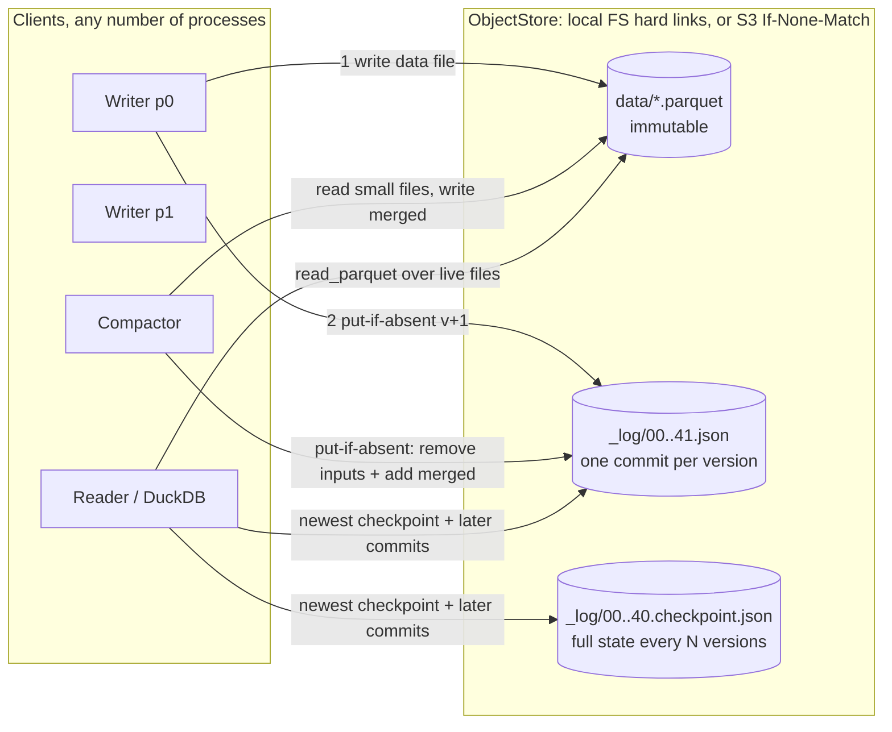
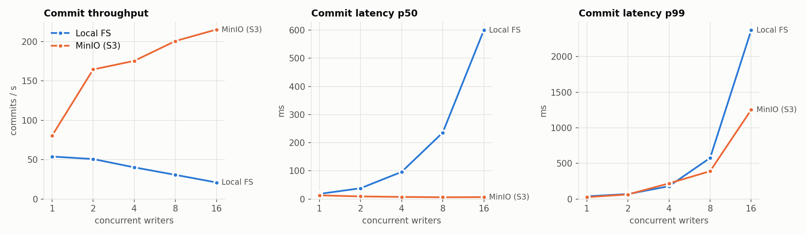
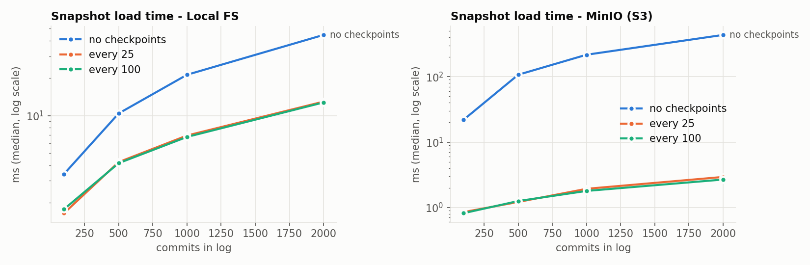
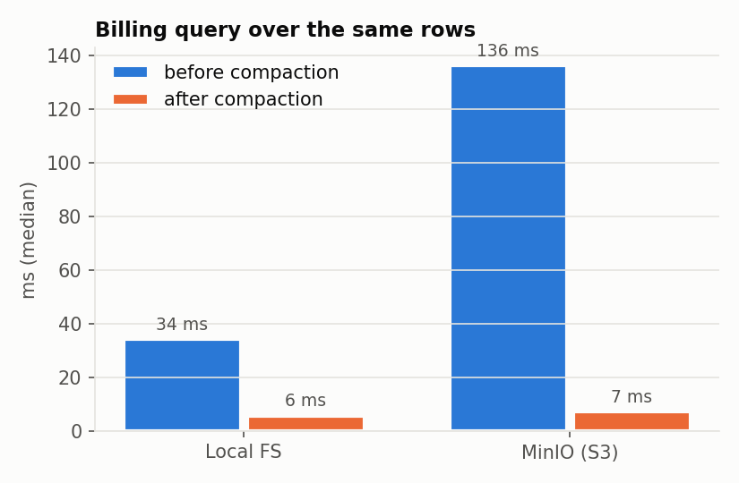
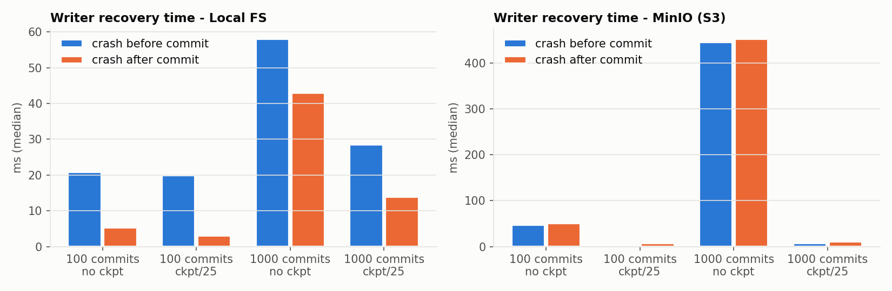

# LedgerTable

[](https://github.com/TreeRoger/ledgertable/actions/workflows/ci.yml)

**A transactional table layer for usage metering on object storage, where no usage record is ever lost or billed twice.**

Usage events (account, resource, compute time, event ID, timestamp) are ingested as Parquet files. The table's state is a versioned transaction log on object storage (a local filesystem or any S3-compatible store with conditional writes). Writers crash, retry, race each other, and run alongside compaction, and events arrive days late. Through all of that, billing totals reconcile **exactly** against ground truth. A Jepsen-style checker that trusts none of the Java code verifies this on every test run.

The core is Java 21: Parquet, the commit protocol, the DuckDB query layer, and the fault-injection harness. Python generates workloads, checks histories, drives real-process SIGKILL chaos, and plots benchmarks. The implementation is original and shares no code with Delta Lake, delta-rs, or Iceberg.

## Quickstart

```bash
make build   # shaded jar + Python env (needs JDK 21, Maven, uv)
make test    # starts a throwaway MinIO, runs Java tests on local FS and S3, then the Python checker suites
make bench   # benchmarks on local FS and MinIO -> bench/results/*.csv, bench/plots/*.png
make demo    # concurrent ingestion, writers killed mid-commit, concurrent compaction, reconciliation, time travel
```

`make docker-test` / `docker-bench` / `docker-demo` run the same targets inside Docker Compose with a MinIO service (see [Docker](#docker)).

Query any snapshot with SQL:

```bash
java -jar target/ledgertable.jar query --table work/demo/table --version 40 \
  "SELECT account_id, SUM(compute_millis) FROM usage GROUP BY 1"
java -jar target/ledgertable.jar statement   --table work/demo/table --as-of 2026-10-29T01:00:00Z
java -jar target/ledgertable.jar corrections --table work/demo/table --from 40
java -jar target/ledgertable.jar log         --table work/demo/table
```

## Architecture



**Commit protocol.** A writer loads the latest snapshot at version `v`, writes its immutable data file under a random name, then tries to create `_log/<v+1>.json` with put-if-absent. That object is the commit point. If another writer already took `v+1`, the writer reads the winning commit, checks it for a real conflict, rebases, and tries `v+2`.

| Concurrent pair | Conflict? | Why |
|---|---|---|
| append / append | no | blind inserts of new files |
| append / compaction | no | compaction only removes files that already existed |
| compaction / compaction | only if they remove a common file | the later one aborts and deletes its output |
| append / the same producer batch | **duplicate** | the later one is acknowledged as a duplicate and its data file is deleted |

**Exactly-once ingestion.** Each producer numbers its batches 1, 2, 3, … and the log records `(producer, seq)` with every append. The snapshot keeps, per producer, the last committed sequence number and its version. A resubmitted batch (after a timeout, a storage error, or a crash) is recognized two ways: in the snapshot before writing, and in winning commits during rebase. Either way it is acknowledged without being counted again. A restarted producer asks the table which batch committed last and resumes after it. No client-side state is needed.

**Ambiguous writes.** If the put-if-absent call itself fails, the writer cannot know whether it landed, so it reads version `v+1` back and compares transaction IDs. It never moves past a version that is still empty, so a delayed duplicate of its own write can only land where the writer would have committed anyway.

**Listing is only a hint.** A directory listing taken while writers commit may skip keys created during it. POSIX `readdir` allows this, and so can paginated S3 listings. Replay therefore uses the listing only to find the newest checkpoint and commit, and fetches every version in between by key. (The randomized checker found this bug; see [Bugs the checker found](#bugs-the-checker-found).)

**Checkpoints.** Every N versions, the committing writer also writes the full table state it already holds in memory, plus an advisory `_last_checkpoint` hint that only narrows the listing. Every replay step re-validates the log invariants: versions are contiguous, timestamps strictly increase, removed files are live, and each producer's sequence numbers are contiguous. A corrupt log fails loudly instead of being misread.

**Billing and late events.** The billing SQL sums integer compute milliseconds per account and UTC event day, so the arithmetic is exact. An event can arrive days late, into a day that was already invoiced. `corrections(from, to)` returns the signed per-account, per-day adjustments and reads only the files that differ between the two versions. Compaction's added and removed files cancel out, so it never produces corrections.

**Time travel.** `snapshotAt(version)` replays from the newest checkpoint at or below that version. `snapshotAsOf(instant)` binary-searches commit timestamps, which strictly increase by construction (`max(now, previous + 1)`).

## Guarantees, and the tests that prove them

Each claim below is backed by a test. Anything not proven is listed under [Limits](#limits).

| Guarantee | Proven by |
|---|---|
| Put-if-absent has exactly one winner, even with 16 concurrent racers per key, on both backends | `ObjectStoreContract` (run for `LocalObjectStore` and `S3ObjectStore` on MinIO) |
| A writer killed at **any** crash point, or hit by any storage fault (error before, error after/ambiguous, crash before, crash after) at **any** storage operation of an append or compaction: <br/>• leaves a table that loads <br/>• keeps acknowledged batches durable <br/>• ends with every batch exactly once after restart <br/>• preserves rows across compaction <br/>• keeps checkpoints equal to full replay | `CrashSweepTest`: exhaustive over 8 crash points, 4 fault kinds, every storage op index, with a competing commit forced into the path so conflict detection and rebase are covered |
| Under concurrent producers, compactors and readers with random crashes and storage errors: <br/>• no acknowledged batch is lost, and its reported version is the one it committed at <br/>• no event is duplicated or invented <br/>• the final table equals the workload exactly <br/>• per-account totals are exact | `py/tests/test_randomized.py` + `ledger.checker` (local FS and MinIO) |
| Every snapshot read returns exactly the batches committed at or before its version, never part of a batch; DuckDB totals match ground truth; as-of reads pick the correct version; a "latest" read never returns a version older than one acknowledged before the read began | `ledger.checker`, reads check |
| Each append commit holds exactly its batch's events; each compaction's output is the exact multiset of its inputs | `ledger.checker`, batches check |
| The invoice at any version plus `corrections` to a later version equals that later version's ground truth, with late events included | `BillingTest`, and `ledger.checker` billing check on every randomized run |
| The same holds with **real processes SIGKILLed** at random: 4 writer JVMs and a compactor JVM, killed and restarted repeatedly | `py/tests/test_process_kill.py` |
| A listing that omits a concurrently created commit cannot corrupt a snapshot or time travel | `LedgerTableTest.listingThatSkipsAConcurrentlyCreatedCommitIsTolerated` and two siblings |
| An ambiguous commit write is resolved by the **transaction ID** stored in the version, not by the version merely existing; a rival's commit there makes the writer rebase | `LedgerTableTest.ambiguousWriteToAVersionAnotherWriterTookIsNotClaimed` (fails if the ID comparison is removed) |
| Producer dedup state survives compaction and checkpoints: a retried batch is recognized after loading from a checkpoint (with the earlier commits hidden), and when it rebases over a checkpointed version | `LedgerTableTest.producerDedupStateSurvivesCompactionAndCheckpoints`, `retriedBatchRacingPastACheckpointIsDeduplicatedDuringRebase` |
| The local store fsyncs file contents before the hard link publishes them, then fsyncs the directory; a losing put publishes nothing | `LocalObjectStoreTest.putIfAbsentSyncsContentsBeforePublishingAndTheDirectoryAfter` (checks call order, not power loss) |

**The checker is tested too.** `py/tests/test_checker.py` takes a real faulty run, then damages the table or history the way a specific bug would. It covers a double-counted batch, a lost ack, a compaction that drops a row, a torn read, a stale latest read, wrong DuckDB totals, a wrong billing correction, a corrupt checkpoint, a log gap, and phantom rows, and asserts the checker reports each one. A deliberate mutation of the Java commit path (treating an ambiguous write as a success) is caught by `CrashSweepTest`.

**Replaying a failure.** A seed fixes the workload and every simulated process's fault schedule. Thread interleavings are not fixed, so a failing seed is replayed by rerunning it, possibly a few times. Failing randomized tests print the exact commands. `LEDGER_SEEDS=1-200 make test-py` runs more seeds.

## Bugs the checker found

[BUGS.md](BUGS.md) gives the symptom, root cause, fix and regression test for each bug.

1. **Listing gaps (a real bug in the table, fixed in `e80446e`).** Under seed 100, a writer listed `_log/` while others were committing, saw version 194 without 193, and died on a spurious `log gap`. That left 30 events missing and per-account totals short.
2. **Reader startup (a bug in the harness).** A reader that hit an injected storage error while opening the table died instead of retrying.

## Benchmark results

All numbers come from **one machine**: an Apple M4 laptop (10 cores, 16 GiB), macOS 26, JDK 21. "S3" is a **single-node MinIO server on the same laptop** (`RELEASE.2025-10-15`), not AWS. Raw CSVs, the machine description and the full tables are in [`bench/results/`](bench/results/summary.md); the plots are generated from them by `python -m ledger.plots`. Each writer appends 50-event batches as its own producer after 5 unmeasured warm-up commits. Medians are reported unless a percentile is stated.

| Headline | Local FS | MinIO |
|---|---|---|
| Commit throughput, 1 → 16 writers | 54 → 21 commits/s | 80 → 215 commits/s |
| Commit latency p50 / p99, 1 writer | 18 / 37 ms | 13 / 25 ms |
| Lost commit races per commit, 16 writers | 13.9 | 8.6 |
| Snapshot load at 2,000 commits, no checkpoints → checkpoint every 25 | 44.5 → 13.0 ms | 436 → 2.9 ms |
| Billing query over 400 small files → 1 compacted file | 34 → 6 ms | 136 → 7 ms |
| Append p50 with 2 concurrent compactors (4 writers) | 96 → 126 ms | 4.6 → 5.1 ms |
| Restarted writer gets its interrupted batch acked, 1,000-commit log, checkpoints on | 14-29 ms | 8-11 ms |



**Contention.** All writers race for one log head, so the number of lost races grows roughly linearly with the number of writers; p99 latency grows with it. On MinIO, throughput still rises to 16 writers, because a lost race costs only a small GET and a retry.

**Local FS is fsync-bound.** On this Mac a `FileChannel.force` costs about 3.7 ms, against 0.07 ms without it. Every local append pays four: the data file, the staged commit file, and both directories. A writer that loses a race has already paid for its staged commit. That is why local throughput *falls* as writers are added. The MinIO server here evidently does not flush the drive on every PUT, so the two columns are **not comparable on durability**. MinIO's numbers say nothing about a real S3 round trip of 10-50 ms.



**Checkpoints matter most on object storage.** Without them, every snapshot load replays the whole log, which means one GET per commit. That costs 436 ms at 2,000 commits on MinIO, and every append pays it, because appends start by loading the latest snapshot. With a checkpoint every 25 versions, a load is one checkpoint read plus at most 24 commits: under 3 ms at any log length tested on MinIO. It still creeps up slowly, because the checkpoint lists every live file, and there are 2,000 here with no compaction. Locally the checkpointed load still grows with log length (13 ms at 2,000 commits). `LocalObjectStore.list` walks the whole `_log/` directory and then filters by the start-after key, whereas S3 applies `start-after` server-side.

 

**Compaction** turns 400 small files into one and cuts the billing query by 6x locally and 19x on MinIO. Running two compactors alongside 4 writers raises append p50 by about 30% locally, because their commits are extra fsyncs and extra log heads to race. On MinIO the increase is about 10%. Appends never conflict with compaction; the added retries are ordinary lost races.

**Recovery** needs no client-side state: open the table, read the producer's last committed sequence number from the snapshot, and resubmit. After a crash *after* the commit, the resubmission is a duplicate ack and nothing is rewritten. After a crash *before* the commit, the batch is written again, and the dead writer's data file is left as an orphan (one per crash, as the table shows).

## Demo

`make demo` runs four writer processes and two compactor processes on one table, then:

1. SIGKILLs writer `p0` right after its commit object is durable but before it acknowledges, so the commit is unacknowledged.
2. SIGKILLs writer `p1` after it wrote a data file but before committing, which leaves an orphaned file.
3. SIGKILLs one compactor after it rewrote files but before its commit, while the other compactor keeps going.
4. Restarts the killed writers, which resume from table state alone.
5. Prints the DuckDB billing statement and checks per-account totals against the workload's ground truth (**exact match** required).
6. Invoices an early version and prints the corrections that the late events produce.
7. Runs the same SQL with time travel, by version and by instant.
8. Runs the independent history checker over all writer histories.

## Docker

The `Dockerfile` builds everything (JDK 21, Maven, Python via uv). `docker-compose.yml` adds a pinned MinIO service and points `LEDGER_S3_ENDPOINT` at it.

```bash
docker compose run --rm ledger make test    # or: make docker-test
docker compose run --rm ledger make bench   # results land in ./bench via a volume
docker compose run --rm ledger make demo
```

**Docker status:** the Dockerfile and compose file are **not yet verified**. Docker was not available on the development machine, and the CI job that builds the image (`docker` in `.github/workflows/ci.yml`) has not run yet, because this repository has not been pushed. Treat Docker as unverified until that job is green.

## CI

`.github/workflows/ci.yml` runs on Ubuntu 24.04:

- Start a MinIO container. It is started with `docker run` rather than as a `services:` entry, because service containers cannot pass the `server /data` arguments the official image needs.
- Build, then run all Java tests (local FS and S3) and all Python tests.
- Chaos run: 12 more high-fault seeds (100-111), the real-process SIGKILL test, and the demo.
- A second job builds the Docker image and runs `make test` inside Docker Compose.

The workflow passes `actionlint`, but it has **not run yet**; the badge goes live after the first push.

## Limits

These are not handled or not proven:

- **Single machine.** Every result here comes from one laptop. The "distributed" parts are many threads and many JVM processes sharing one directory, or one single-node MinIO server on localhost. Nothing has run across machines or against real AWS S3, and network partitions are not tested.
- **Fault model: process crashes, not power loss.** The tests cover crash-stop processes, and storage operations that each either happen or don't. An "error after" fault models a write that landed but reported an error. The local store fsyncs file contents before publishing and fsyncs the directory afterwards, and a test checks that order. Nothing simulates power loss, so the proven guarantee is **consistency across process crashes**. Durability across power loss is only as good as the platform's fsync; on macOS, `fsync` alone does not flush the drive cache. Storage losing acknowledged writes, bit rot, and Byzantine clients are out of scope.
- **Producer contract.** Exactly-once relies on each producer numbering its batches 1, 2, 3, … and resubmitting the *same* events under the same `(producer, seq)`. If a client reuses a sequence number for different events, the first write wins. The table cannot detect that. Event IDs are not deduplicated across different batches.
- **Throughput ceiling.** All commits serialize on one log head. Commit throughput is bounded by put-if-absent latency, and contention adds retries roughly linearly with the number of writers (see the benchmarks). The log is not partitioned, and batches from many producers are not group-committed.
- **Garbage.** Data files orphaned by crashed writers are harmless, since nothing references them, but nothing removes them. There is no vacuum, and old log entries are kept forever, which keeps time travel to every version possible.
- **Single table, single schema.** No schema evolution, no partitioning, no multi-table transactions.
- **Time travel by instant** uses writer wall clocks, made strictly increasing per commit. Between writers whose clocks disagree, "as of 12:00" means as of the commit timestamps, not true real time.

## Layout

```
src/main/java/dev/ledgertable/
  store/     ObjectStore, LocalObjectStore (link(2) put-if-absent), S3ObjectStore (If-None-Match)
  log/       commit/checkpoint records, key layout, strict JSON codec
  core/      LedgerTable (commit protocol, append, compact, time travel), Snapshot (validated replay)
  io/        Parquet encode/decode over byte arrays
  query/     DuckDB over any snapshot (view `usage`)
  billing/   statements and late-event corrections
  fault/     crash points, SimulatedCrash, fault-injecting store
  harness/   concurrent faulty clients recording a Jepsen-style history
  bench/     benchmarks writing raw CSV
  cli/       the `ledger` command
py/ledger/   workload.py, tablelog.py (independent log replay), checker.py, chaos.py, demo.py, plots.py
py/tests/    checker tamper tests, randomized seeds (local + S3), real-process SIGKILL test
bench/       results/*.csv (raw), results/summary.md, plots/*.png
```

## License

[MIT](LICENSE)
